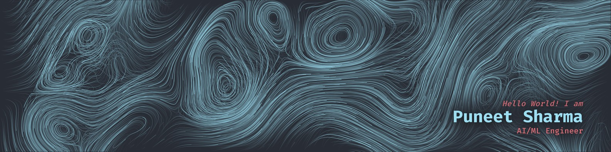
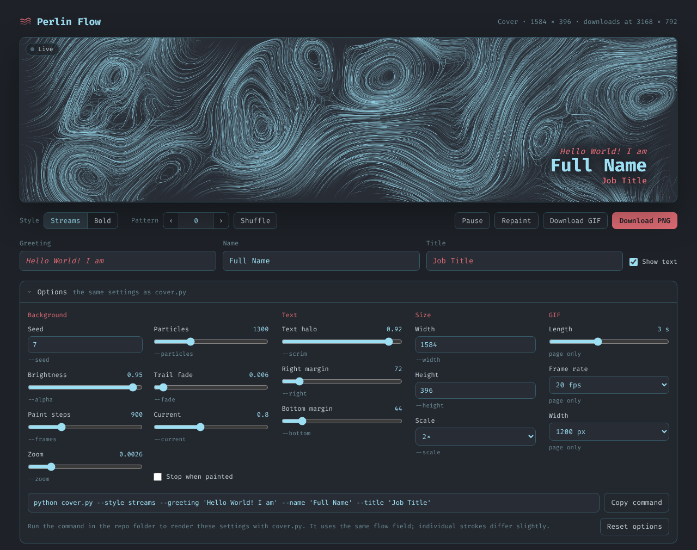
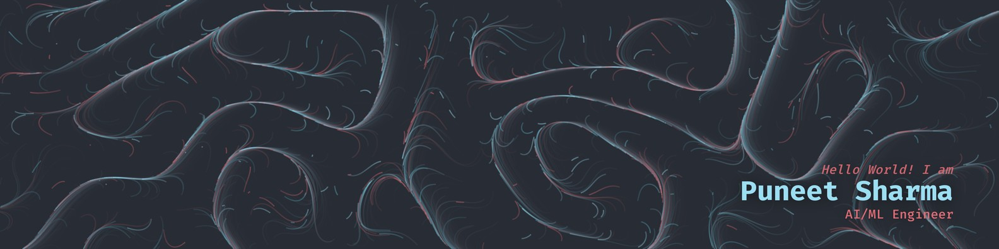

<h1>
  
  Perlin Flow
</h1>

Generate a cover with a Perlin-noise flow field background,
optionally with your name in the corner. Use it live in the browser, or render
it from a Python script.



## Features

- **Two background styles:** silky *Streams* and colourful *Bold*.
- **Live browser version:** a small static page (`index.html`, `style.css`, `script.js`) with an animated preview, editable text and one-click PNG download. Nothing to install.
- **Looping GIF:** **Download GIF** records a short clip of the motion that loops seamlessly, encoded with [gifenc](https://github.com/mattdesl/gifenc).
- **Python command-line tool** for scripted, repeatable renders: just the background by default, with your text added through options.
- **Same options in both:** the Python script's background, text and size settings are also in the browser's **Options** panel, and **Copy command** gives you the matching `python cover.py …` line.
- **Endless layouts:** every pattern number gives a new flow, and the numbers are shared between the browser and Python versions.
- **LinkedIn-ready:** exports at 3168 × 792 (2× LinkedIn's 1584 × 396), with the text in the bottom-right, clear of the profile photo.

## Quick start

### In the browser

Open `index.html` in a modern browser (tested in Chrome), keeping `style.css`
and `script.js` in the same folder. Nothing to install; the Fira Code font loads
from Google Fonts, so be online for the text to use it. Because the page is named `index.html`, you can also turn on GitHub Pages
for this repo and use it straight from the web.

1. Pick a style, and step through patterns or press **Shuffle**.
2. Type your greeting, name and title.
3. Open **Options** to fine-tune particles, brightness, trails, text placement and size.
4. The flow keeps drifting, so **Pause** on a frame you like, then **Download PNG**.
   Tick **Stop when painted** to stop at exactly the frame the Python script would save.
5. Or press **Download GIF** for a looping clip of the motion. Set its length,
   frame rate and width under **Options → GIF**. *Streams* has very fine detail,
   so it needs 1200 px or more to look crisp, and its GIFs are large: about
   13 MB at 1200 px for 3 seconds, or about 23 MB at 1584 px. *Bold* is roughly a
   third of that. LinkedIn cover photos don't animate, so use the PNG there and
   the GIF for posts, a README or a portfolio.



### With Python

```bash
pip install -r requirements.txt
python cover.py                                                  # background only
python cover.py --style streams --name "Full Name" --title "Job Title"   # with text
```

This saves `cover.png`. Text is optional: the first time you add
some, the script downloads the Fira Code font (about 260 KB) and stores it
next to itself.

## Styles

| Style | Look | Python render time* |
| --- | --- | --- |
| `streams` | Silky cyan strokes that swirl into eddies and sweep along a gentle current | ~25 s |
| `bold` | Cyan, coral and teal dot trails that gather into feathered lines | ~1 min |

<sub>*Measured on a 2-core machine; yours may differ. The browser version paints in a few seconds.</sub>

**Bold**



## Command-line options

The browser's **Options** panel has the same settings under the same names, and
**Copy command** turns whatever you set there into a ready-to-run command. The
font, output file and `--no-text` options are Python-only, and the GIF settings
are browser-only. Run `python cover.py --help` to see each option's suggested
range.

| Option | Default | What it does |
| --- | --- | --- |
| `--style` | `bold` | Background preset: `streams` or `bold` |
| `--pattern` | `0` | Swirl layout; every number gives a different one |
| `--seed` | `7` | Reshuffles the individual particles within the same layout |
| `--particles` | per style | Number of particles (density) |
| `--alpha` | per style | Particle brightness, 0–1 |
| `--fade` | per style | Trail fade per frame; lower means longer trails |
| `--frames` | per style | Number of simulation steps |
| `--radius` | per style | Dot radius in px (`bold` only) |
| `--current` | `0.8` | `streams`: strength of the steady drift; `0` gives only eddies |
| `--zoom` | `0.0026` | `streams`: noise frequency; higher means smaller swirls |
| `--greeting` | none | Line above the name (italic, coral), e.g. `"Hello World! I am"` |
| `--name` | none | Name (bold, cyan), e.g. `"Full Name"` |
| `--title` | none | Line below the name (coral), e.g. `"Job Title"` |
| `--no-text` | off | Skip the text, even if given |
| `--scrim` | per style | 0–1 dark halo behind the text, for busy backgrounds |
| `--right` / `--bottom` | `72` / `44` | Text margins from the right and bottom edges (px at 1×) |
| `--font` | `FiraCode-VF.ttf` | Path to a Fira Code `.ttf` file |
| `--width` / `--height` | `1584` / `396` | Cover size in px at 1× |
| `--scale` | `2` | Output scale; `2` gives 3168 × 792 |
| `--out` | `cover.png` | Output file |

Text is optional. Give any of `--greeting`, `--name` and `--title`; lines you
leave out are skipped, and with none of them you get the background only.
Options that don't apply to the chosen style (`--radius` with `streams`,
`--current` or `--zoom` with `bold`) are skipped with a short note.

### Examples

```bash
python cover.py --style streams --pattern 3        # a different swirl layout
python cover.py --style streams --current 0        # all eddies, no drift
python cover.py --style streams --zoom 0.004       # smaller, busier swirls
python cover.py --particles 1800 --fade 0.015      # denser bold style, longer trails
python cover.py --out bg.png                       # background only (the default)
python cover.py --style streams --greeting "Hello World! I am" --name "Full Name" --title "Job Title"
```

## Patterns and seeds

- `--pattern` (the **Pattern** control in the browser) picks a different region
  of the noise, so the swirls themselves move. Both versions use bit-identical
  noise, so the same number gives the same layout in each.
- `--seed` only changes where individual particles start, giving the same
  layout with different strokes.

The exact strokes always differ a little between the two versions, because the
particles are random and the browser version keeps drifting over time.

## How it works

1. **Noise:** a seeded 2-D gradient (Perlin) noise gives a smooth value
   everywhere on the cover. The grid is rotated so its cells never line up
   with the edges.
2. **Flow field:** in the *Bold* style the noise value is turned into a heading,
   and each particle steps that way every frame. In *Streams*, particles
   instead follow the curl of a noise "stream function" plus a steady current.
   A curl field has no sources or sinks, which is what gives the swirling
   eddies.
3. **Trails:** nothing is erased between frames; the image only fades slowly
   toward the background, so every particle leaves a trail. Streams strokes are
   tapered with a sine envelope over each particle's life.
4. **Text (optional):** Fira Code, right-aligned in the bottom-right corner. It has a soft
   drop shadow and, in *Streams*, a dark halo so it stays readable over busy
   lines.

## Customising

- **Colours:** in `cover.py`, edit `BG_HEX`, `FLOW_COLORS`,
  `NAME_HEX`, `ACCENT_HEX` and `STREAM_HEX` near the top. For the browser
  version, edit `BG`, `CYAN`, `CORAL` and `TEAL` at the top of `script.js`,
  and the CSS variables in `style.css` for the page itself.
- **Presets:** each style's settings live in `STYLES` in both `cover.py` and
  `script.js`. Keep the two in sync if you want pattern numbers to keep matching.

## Uploading to LinkedIn

Upload the PNG as your profile's background photo. LinkedIn's recommended size
is 1584 × 396; this tool exports at exactly twice that, at the same 4:1 ratio,
so it stays sharp on high-resolution screens. If the upload is ever refused for
size, render at 1× with `--scale 1`.

## Project structure

```
.
├── cover.py              # Python generator (command line)
├── index.html            # Browser version: the page
├── style.css             # Browser version: styles
├── script.js             # Browser version: simulation, text and controls
├── icon.svg              # Logo
├── docs/                 # Images used in this README
├── requirements.txt      # numpy, Pillow
└── LICENSE               # MIT
```

## Requirements

- **Browser version:** a modern browser (tested in Chrome) and an internet
  connection for the Fira Code font and the GIF encoder. Everything else works
  offline.
- **Python version:** Python 3.8 or newer, with `numpy >= 1.17` and `Pillow >= 9.1`.

## License

Code: [MIT](LICENSE) © 2026 Puneet Sharma.

Font: [Fira Code](https://github.com/tonsky/FiraCode) © The Fira Code Project
Authors, under the [SIL Open Font License 1.1](https://github.com/tonsky/FiraCode/blob/master/LICENSE).
It isn't stored in this repo: the HTML page loads it from Google Fonts and the
Python script downloads it on first use.

GIF encoding: [gifenc](https://github.com/mattdesl/gifenc) 1.0.3 © Matt DesLauriers,
MIT License, loaded by `index.html` from jsDelivr when the page opens.
